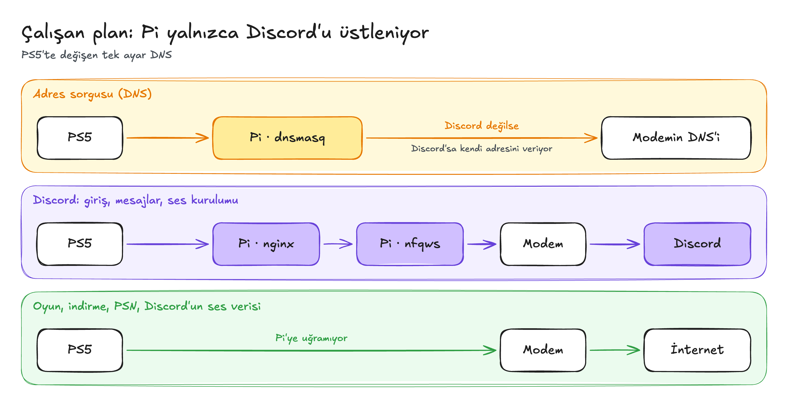
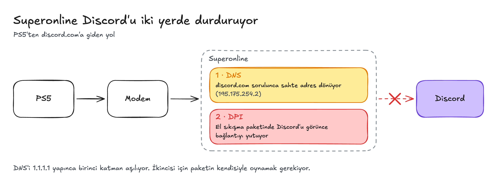
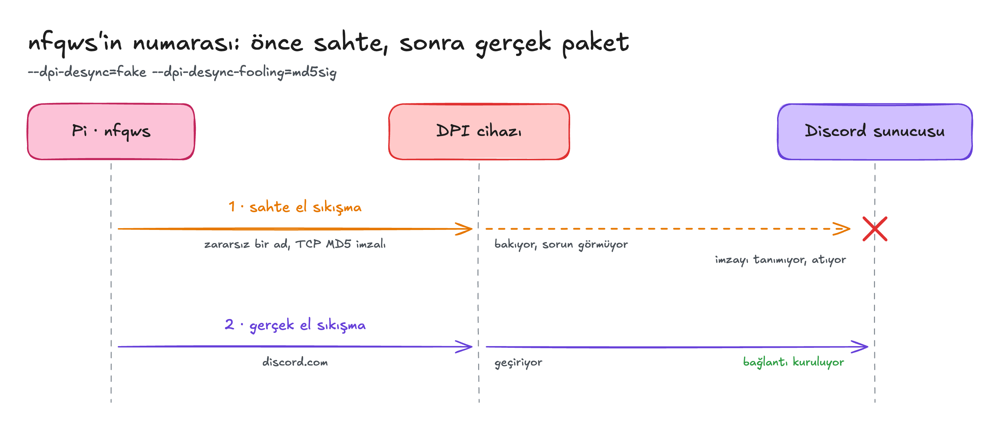

# PS5'te Discord nasıl açılır?

Türkiye'de Discord engelli, PS5'e de GoodbyeDPI kurulamıyor. Bu depo, modemin yanına konan bir Raspberry Pi Zero 2 W ile PS5'te Discord'u açmanın ayar dosyalarını ve adımlarını içeriyor. PS5'te değişen tek şey DNS ayarı. Oyun, indirme, PSN, hiçbiri Pi'ye uğramıyor, o yüzden hız da ping de aynı kalıyor.



Turkcell Superonline hattında, TP-Link EX530v modemle ve kabloyla bağlı bir PS5 ile denendi. Başka operatörde engeli aşan yöntem farklı olabilir, 3. adım bunun için var.

Nasıl buraya geldiğimizin hikayesi, patlayan denemeler dahil, [berkay.cloud'daki yazıda](https://berkay.cloud/blog/ps5-discord-pi-zero/).

## Nasıl çalışıyor

Superonline Discord'u iki yerde durduruyor. DNS sahte adres dönüyor, DNS'i değiştirsen bile aradaki DPI cihazı TLS el sıkışmasında Discord'un adını görünce bağlantıyı yutuyor.



Pi'de üç parça çalışıyor.

- dnsmasq, Discord'un alan adları sorulunca Pi'nin kendi adresini veriyor. Geri kalan sorgular modemin DNS'ine gidiyor.
- nginx, PS5'ten gelen bağlantının el sıkışmasındaki sunucu adını okuyup bağlantıyı Discord'un gerçek adresine aktarıyor. TLS'i çözmüyor, Discord dışındaki adları reddediyor.
- [zapret](https://github.com/bol-van/zapret)'in `nfqws` aracı, Pi'den çıkan el sıkışma paketinin önüne sahte bir paket koyup DPI'ı atlatıyor.



Discord'un ses verisi (UDP) Pi'den geçmiyor, PS5'ten doğrudan Discord'a gidiyor.

## Ne lazım

- Raspberry Pi Zero 2 W ya da Linux çalıştıran başka bir kart, Raspberry Pi OS Lite (64-bit) kurulu
- Pi'nin modemle aynı ağda sabit bir adresi (burada `192.168.1.250`, modem `192.168.1.1`)
- Pi'ye SSH erişimi ve `sudo`

Pi'yi modemin yanına koy. Zero 2 W yalnızca 2,4 GHz görüyor ve sinyal zayıflayınca Discord kullanılmaz hale geliyor.

## Kurulum

Komutlar Pi'de çalışıyor. Önce depoyu Pi'ye al.

```bash
sudo apt update && sudo apt install -y git
git clone https://github.com/BerkayClik/ps5-discord-pi-zero
cd ps5-discord-pi-zero/pi
```

### 1. Engeli kendi hattında gör

```bash
getent hosts discord.com                                   # Pi'nin DNS'i 1.1.1.1 ise gerçek adresler gelir
curl -m 8 -o /dev/null -w "%{http_code}\n" https://discord.com/   # engel varsa 000 ve zaman aşımı
```

### 2. zapret'i indir

```bash
V=v72.13
curl -sSLO https://github.com/bol-van/zapret/releases/download/$V/zapret-$V.tar.gz
curl -sSLO https://github.com/bol-van/zapret/releases/download/$V/sha256sum.txt
tar xzf zapret-$V.tar.gz
grep linux-arm64/ sha256sum.txt | sha256sum -c -
sudo mkdir -p /opt/zapret && sudo cp -a zapret-$V/. /opt/zapret/
```

### 3. Hattında tutan yöntemi bul

`try-strategy.sh` bir yöntemi geçici olarak açıp Discord'u deniyor, sonra her şeyi geri alıyor.

```bash
sudo sh try-strategy.sh ""                                                # yöntemsiz: 000 beklenir
sudo sh try-strategy.sh "--dpi-desync=fake --dpi-desync-fooling=md5sig"   # Superonline'da tutan
```

`discord.com -> 200` görüyorsan o yöntem tutuyor. Bizim hatta sonuçlar şöyleydi.

| Yöntem | Sonuç |
|---|---|
| `multisplit` | 0,2 saniyede kesildi |
| `multidisorder` | 0,2 saniyede kesildi |
| `fake`, TTL 3 | zaman aşımı |
| `fake` + `multisplit`, TTL 3 | 0,2 saniyede kesildi |
| `fake`, `md5sig` | açıldı |

Hiçbiri tutmazsa zapret'in içindeki `blockcheck.sh` çok daha fazla kombinasyonu deniyor. Tutan yöntem farklıysa `ps5gw.service` dosyasındaki `ExecStart` satırını ona göre değiştir.

### 4. Ayar dosyalarını üret

Adreslerin buradakilerle aynıysa olduğu gibi çalıştır, değilse başına kendi değerlerini yaz.

```bash
./make-config.sh
# ya da: PI_IP=192.168.0.50 MODEM_IP=192.168.0.1 ./make-config.sh
```

`out/` klasörüne `dnsmasq-ps5gw.conf` ve `nginx.conf` yazılıyor. Alan adı listesi `discord-hosts.txt` dosyasında.

### 5. Paketleri kur, dosyaları yerine koy

```bash
sudo apt install -y --no-install-recommends nginx-light libnginx-mod-stream dnsmasq

sudo mkdir -p /opt/ps5gw
sudo install -m 644 discord-hosts.txt rules.nft /opt/ps5gw/
sudo install -m 644 ps5gw.service /etc/systemd/system/ps5gw.service
sudo install -m 644 out/dnsmasq-ps5gw.conf /etc/dnsmasq.d/ps5gw.conf
sudo cp /etc/nginx/nginx.conf /etc/nginx/nginx.conf.orig
sudo install -m 644 out/nginx.conf /etc/nginx/nginx.conf
echo nfnetlink_queue | sudo tee /etc/modules-load.d/ps5gw.conf
```

`nginx.conf` Pi'deki dosyanın yerine geçiyor. Pi'de nginx'i başka iş için de kullanıyorsan `stream` bloğunu kendi dosyana elle taşı.

### 6. WiFi güç tasarrufunu kapat ve servisleri başlat

```bash
printf "[connection]\nwifi.powersave = 2\n" | sudo tee /etc/NetworkManager/conf.d/wifi-powersave-off.conf
sudo iw dev wlan0 set power_save off

sudo nginx -t
sudo systemctl daemon-reload
sudo systemctl enable --now ps5gw
sudo systemctl restart nginx dnsmasq
sudo systemctl enable nginx dnsmasq
```

### 7. PS5'e dokunmadan önce dene

Aynı ağdaki başka bir bilgisayardan çalıştır.

```bash
dig +short discord.com @192.168.1.250        # 192.168.1.250 dönmeli
dig +short google.com @192.168.1.250         # gerçek adres dönmeli
curl -s -o /dev/null -w "%{http_code}\n" --resolve discord.com:443:192.168.1.250 https://discord.com/    # 200
```

### 8. PS5 ayarı

Ayarlar, Ağ, Ayarlar, İnternet Bağlantısını Kur, kullandığın bağlantının Gelişmiş Ayarlar'ı. DNS Ayarları'nı Manuel yap.

- Birincil DNS: `192.168.1.250`
- İkincil DNS: `1.1.1.1`

İkincil DNS, Pi kapanırsa oyunların çalışmaya devam etmesi için. Bedeli aşağıda.

## Takılırsan

Sesli sohbet "katılınıyor"da kalıyorsa portlara bak. Discord ses sunucusuna 443'ten değil, Cloudflare'in öbür HTTPS portlarından bağlanıyor (bizde 2053 çıktı). `rules.nft` ve nginx ayarı bu yüzden 2053, 2083, 2087, 2096 ve 8443'ü de dinliyor.

Discord "yükleniyor"da kalıyorsa PS5 büyük ihtimalle adresi ikincil DNS'e sormuş, gerçek adresi alıp engele takılmıştır. PS5'i yeniden başlat. Sık oluyorsa ikincil DNS'e de Pi'nin adresini yaz.

Her şey ağırlaştıysa Pi'nin sinyaline bak. Bizde Pi modemden uzaklaşınca sinyal -78 dBm'e düştü ve Pi Discord'un ana sayfasını sekiz saniyede indiremedi.

```bash
iw dev wlan0 link | grep signal
```

PS5'in Pi'ye ne sorduğunu ve nereye bağlandığını görmek için Pi'deki günlüklere bakabilirsin.

```bash
tail -f /var/log/nginx/stream.log        # Pi üzerinden geçen her Discord bağlantısı
sudo journalctl -u ps5gw -n 20           # nfqws
```

## Bilmen gerekenler

- Pi kapanırsa Discord da gidiyor. İkincil DNS sayesinde geri kalan her şey çalışmaya devam ediyor.
- Discord'un mesaj ve dosya trafiği Pi'nin WiFi hızına bağlı. Küçük bir dosyada 11 Mbps ölçtük.
- PS5'in ağ geçidini Pi yapmayı deneme. Biz denedik, NAT'sız halinde indirmeler 32 kilobayttan sonra durdu, NAT'lı halinde de PS5'in bütün trafiği Pi'nin WiFi hızına iniyor.
- Yöntem operatöre göre değişiyor. Burada yazan `md5sig` Superonline'da tuttu.

## Dosyalar

| Dosya | Ne işe yarıyor |
|---|---|
| `pi/discord-hosts.txt` | Discord'un alan adları |
| `pi/make-config.sh` | Listeden dnsmasq ve nginx ayarlarını üretir |
| `pi/rules.nft` | El sıkışma paketlerini nfqws'e yollayan nftables kuralı |
| `pi/ps5gw.service` | nfqws'i ve kuralı açılışta başlatan servis |
| `pi/try-strategy.sh` | Bir nfqws yöntemini geçici olarak dener |
| `diagrams/*.excalidraw` | Görsellerin Excalidraw kaynağı, excalidraw.com'da açıp düzenleyebilirsin |
